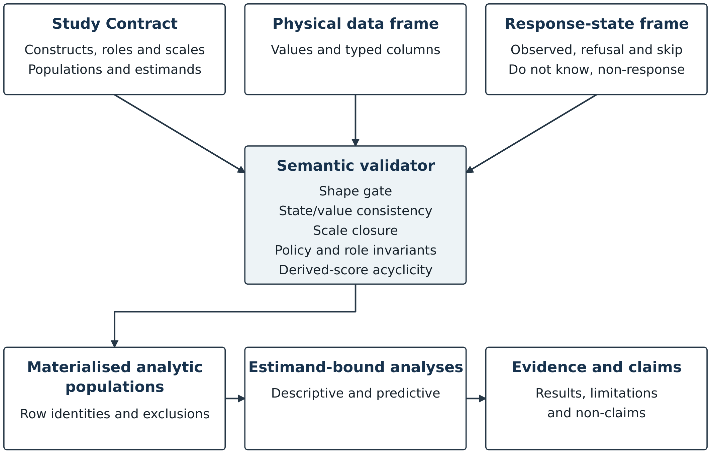
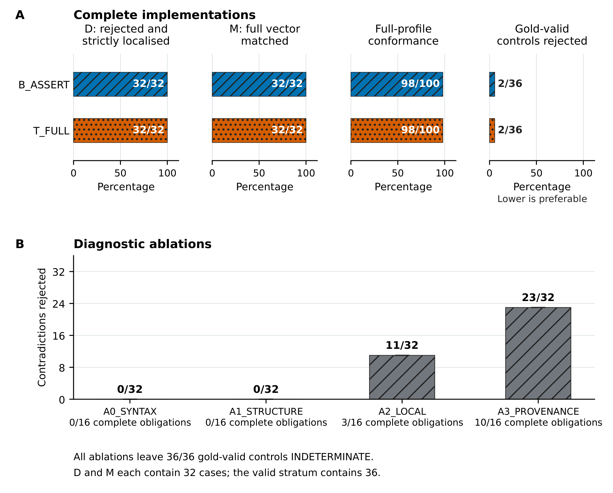
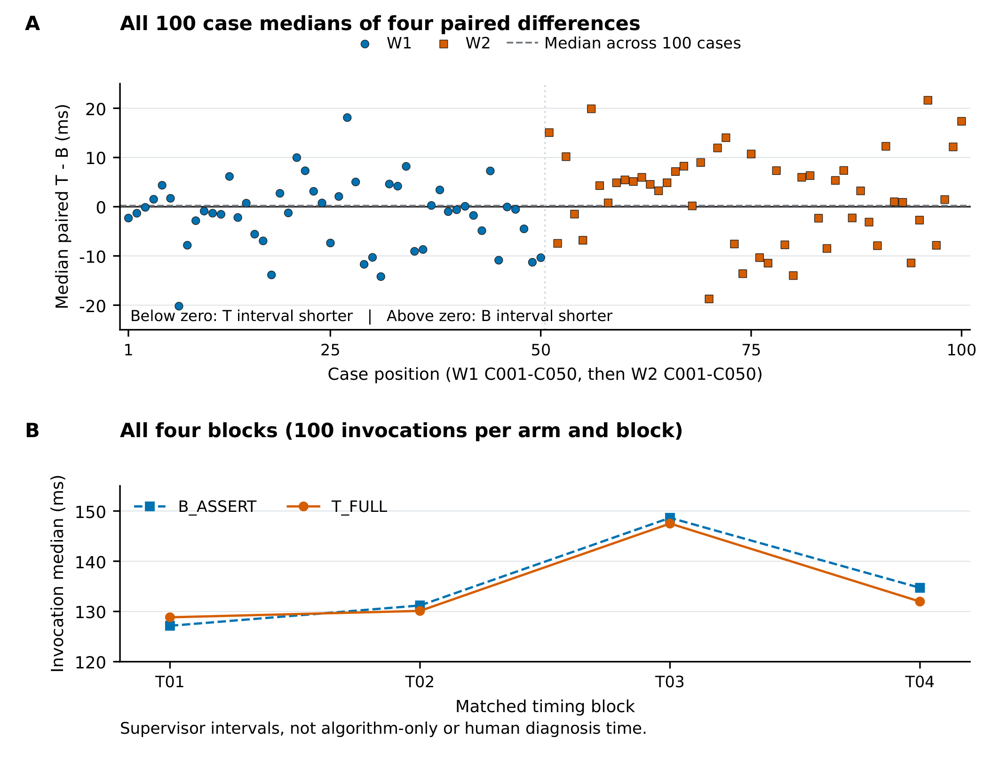
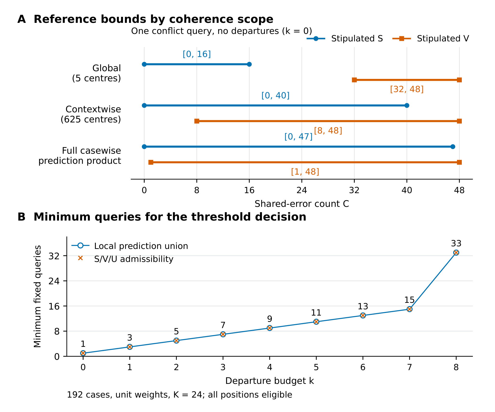

# Figure gallery and captions

[Return to the figure guide](README.md)

## Figure 1. Study Contract workflow

Conceptual Study Contract workflow. The contract, physical data frame and co-indexed response-state frame feed the semantic validator. Materialised populations feed estimand-bound analyses, whose results support evidence and claims. Arrows denote declared conceptual dependencies. The diagram provides the study-contract design context for the finite verification profile.

[Editable ODG](01_editable_odg/JSS_Figure_1_Study_Contract.odg)

## Figure 2. Functional outcomes

Functional performance on the finite benchmark. Panel A shows both complete implementations across the contradiction (D), missing-evidence (M), full conformance and gold-valid rejection outcomes. Strict localisation requires the registered witness. Both implementations reject two of 36 gold-valid cases. Panel B shows rejection counts and complete obligation coverage for four ablations. Each ablation returns INDETERMINATE on all 36 gold-valid controls. The observed performance refers to the frozen benchmark.

[Editable ODG](01_editable_odg/JSS_Figure_2_Functional_Outcomes.odg)

## Figure 3. Supervisor timing

Supervisor interval differences and block medians. Panel A uses each case’s median of four paired T_FULL minus B_ASSERT intervals. Its dashed line is the median across 100 case values. Panel B shows each arm’s invocation median within a block, using all 100 cases per arm and block. The panel B axis begins above zero. Intervals cover declared supervisor work and exclude final receipt writing. The 800 invocations are repeated observations on one host.

[Editable ODG](01_editable_odg/JSS_Figure_3_Supervisor_Timing.odg)

## Figure 4. Reference bounds and query minima

Exact reference-model sensitivity on the retained 192-case frame. Panel A joins the sharp endpoints of each attainable count set for C, conditional on a stipulated S or V adjudication of the same archived conflict case, with departure budget k = 0. Global coherence uses five joint centres; contextwise coherence uses all 625 assignments across the four contexts. The full casewise prediction product is evaluated separately by coordinate extrema, without enumerating all joint centres. Panel B gives the minimum number of distinct fixed queries needed to decide C ≤ 24 versus C > 24 for budgets k = 0,...,8 under the five global conventions, unit weights, no prior observations and eligibility of every frame position. The local prediction union and S/V/U admissibility give the same nine minima. The panels report exact properties of the declared reference models.

[Editable ODG](01_editable_odg/JSS_Figure_4_Reference_Audit.odg)
